# 64 — Demo Presenter Guide: script and flows

Version 1.0, 2026-10-22. For the presenter of the ZOAURO admin panel demo on **Thursday 2026-10-23 at 15:00 IST**, and for anyone who wants to understand how the panel works.

This guide tells you, part by part, from sign-in to the roadmap:

- **Do**: where to click;
- **They see**: what appears on the screen;
- **Say**: words you can read out as they are;
- **How it works**: the flow behind the screen, so you can answer questions.

Doc 61 is the technical runbook (start commands, data reset, QA status of each step). This guide is the story. If a step here is marked **Plan only**, it is not built yet: show it from the workflow map (`60_Admin_Workflow_Map.html`) and do not click it in the panel.

## Changed since the last build

For the owner. Updated with every demo build. Newest first.

**Landed in the code since the morning build; shows from the next demo build (freeze 11:15, final build 11:30, checked about 12:00–13:30):**

- **New: Advertising is live** in the menu (Support & Engagement → Advertising), with Dashboard, Requests, Campaigns and Slots, and its sample data (Part 17).
- **New:** a primary can **Reset 2-step** for another Super Admin (Part 7).
- **Changed:** suspending or reactivating a Zonal Admin now asks for the password.
- **New:** the payout detail page (money block, Orders, Refunds and Ad fees tabs), summary tiles, Export CSV, Print statement, and partner payouts with Mark paid (Part 16). Ad fees are deducted from vendor payouts.
- **Fixed:** a vendor with no zone offers "assign a zone first" instead of Start review.

**Lands in the "final-2" build (13:00, checked 13:25–14:15; the 11:30 build is the fallback):**

- payout **Hold / Release / Adjust** with reasons, and **Make payout** (method, reference, "made by") with an Activity list (Part 16);
- **Edit responsibility** on a decided refund, so ZOAURO can take the cost (Part 15).

**Morning build `3f9dc30` (2026-10-23, about 09:40), fresh sample data:**

- **Changed:** a new **Audit & Logs** menu group holds Audit & Logs, Recent Activities, Access History and Settings History. Search is in the top bar only ("See all results for …").
- **Changed:** **Advertising** appears in the menu as "Soon", with its plan, until the screens land (Part 17).
- **Changed:** both `127.0.0.1:3100` and the new tunnel link work for sign-in. The link changes on every restart, so share only the current one.
- **Fixed:**
  - a refused sign-out now says why;
  - a page that fails to load part of itself reloads once;
  - menu badges load in one call (faster pages).

**Evening build `00b4ecf` (2026-10-22, 18:12), data reset at 19:05:**

- **New: automatic partner assignment** for one zone (Tiruppur pilot), Part 12.
- **New: cancel only up to the zone's stage.** Admins can't cancel an order that is out for delivery; Cancel is hidden there. Part 12.
- **New: Mark paid** on vendor payouts, with the bank reference, held back while a refund is open. Part 16.
- **New: exports** of Payments, Refunds and Payouts.
- **Fixed:**
  - the dashboard follows the top-bar zone;
  - table headers stay light when Windows is in dark mode;
  - the onboarding "Asked: …" note stays in its column.
- **Changed:**
  - list headers are tinted and hovered rows are coloured;
  - "Remember me" follows the Control Panel setting.
- **Sample data:** Karthik now has two Coimbatore North requests (menu view and menu edit), Part 19. Coimbatore Central payouts include one with a refund deduction and one held by an open refund.
- **Demo address:** the demo opened on the owner's shareable tunnel link (Part 1).

## Contents

0. Changed since the last build
1. Before you start
2. The big picture (3 min)
3. Sign-in and security (4 min)
4. Dashboard, search and activity (4 min)
5. Zones (5 min)
6. Control Panel: rules without code (8 min)
7. People and access (8 min)
8. Vendor onboarding and vendors (10 min)
9. Menus and food item requests (4 min)
10. Hotels and bookings (3 min)
11. Vendor plans (packages) (3 min)
12. Orders (10 min)
13. Delivery partners and cash on delivery (4 min)
14. Customers and reward points (3 min)
15. Money: refunds and payments (5 min)
16. Vendor and partner payouts (8 min)
17. Advertising (10 min)
18. Support and notifications (4 min)
19. The Zonal Admin view (6 min)
20. The Admin (second Super Admin) view (3 min)
21. Audit trail (2 min)
22. What comes next (3 min)
23. Questions you may get
24. If something goes wrong
25. One-page running order

---

## 1. Before you start

**Open these browser tabs**, in this order:

| Tab | Address | Why |
|---|---|---|
| 1 | `http://127.0.0.1:3100` on the demo laptop. Guests use the shareable tunnel link announced after each demo start; it changes on every restart. | The admin panel (demo build, sample data) |
| 2 | `http://127.0.0.1:8025` | Mailpit: the inbox where the 2-step sign-in codes arrive |
| 3 | `docs/F-execution/60_Admin_Workflow_Map.html` | The workflow map, for "the big picture" and anything marked Plan only |

**Accounts.** The five demo logins, their passwords and which inbox receives each code are in the local workbook `ZOAURO_Demo_Credentials.xlsx` at the project root. It is never committed to git. Keep it open on your own screen, not on the projector.

| Person | Role | Sign-in tab | What you show with this account |
|---|---|---|---|
| Arun Prakash | Primary Super Admin | Super Admin | Everything: all zones, Control Panel, access, approvals |
| Meena Sundaram | Admin (a second Super Admin with only some Control Panel areas) | Super Admin | How the owner shares work without sharing every power |
| Karthik Raj | Zonal Admin of two zones: Coimbatore Central and Coimbatore North | Zonal Admin | Zone switcher, refund limits, access request |
| Priya Venkatesh | Zonal Admin, Coimbatore Central only, "Menu Desk" job | Zonal Admin | Two admins in one zone with different jobs |
| Suresh Kumar | Zonal Admin, Tiruppur only | Zonal Admin | One zone, no switcher, hotel booking off in his zone |

**The sample world** (all invented, no real customer data):

- 4 zones: Coimbatore Central (CBE, delivery ₹30), Coimbatore North (CBN, ₹35), Tiruppur (TUP, ₹40, hotel booking off) and Pollachi (PLC, Upcoming, not live yet).
- 16 vendors at every onboarding stage, 38 menu items, 9 delivery partners, 24 customers, about 590 orders over 30 days plus a live board for today, 4 hotels with room and table bookings, 6 support tickets, 8 refunds, notifications and promotions.

**Live actions use up sample records.** Each "approve" or "verify" in this guide changes the data. After a rehearsal, ask for a data reset (doc 61 §1) so the real demo starts fresh.

---

## 2. The big picture (3 min)

**Do:** tab 3, the workflow map, section 01 "System flow".

**Say:**
> "ZOAURO has three apps: one for customers, one for vendors (restaurants, Home Food cooks and hotels) and one for delivery partners. This admin panel sits in the middle. Everything the apps send comes here first. Our team checks it, decides, and the decision goes back to the apps. Today I will show the admin panel with sample data. The apps connect in the next phase."

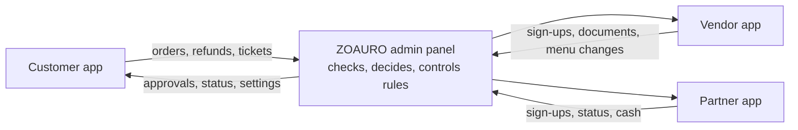

**Say:**
> "Three ideas run through the whole panel.
> First, **zones**. The business is split into zones by pincode. Every vendor, partner and order belongs to exactly one zone.
> Second, **two kinds of admin**. A Super Admin sees every zone. A Zonal Admin sees only the zones and the actions we give them. The server checks this on every request, not just the menu.
> Third, **every business rule is a setting**. Limits, charges, cycles and reasons are changed from the Control Panel, per zone, without a developer and with a full history."

**How it works**

- The panel is one web app with two areas: `/super-admin/...` for Super Admins and `/zone/...` for Zonal Admins. A Zonal Admin's menu is built from their permissions.
- If a Zonal Admin opens a record from a zone that is not theirs, the server answers "not found", even if they type the address by hand.

---

## 3. Sign-in and security (4 min)

**Do:**

1. Tab 1, the sign-in page. Choose the **Super Admin** tab.
2. Type Arun's email and password. Click **Sign in**.
3. On the 2-step page, choose **Email code**. Open tab 2 (Mailpit), copy the 6-digit code, and type it back in tab 1.

**They see:** the sign-in card with the two tabs, then a 2-step page with the choices Authenticator app and Email code, then the dashboard.

**Say:**
> "Every admin signs in with a password and a second step: a code from an authenticator app or a code sent by email. It is required for both roles. After five wrong passwords the account locks for 30 minutes. A Zonal Admin who uses the Super Admin tab cannot get in; they get the same message as a wrong password, so nobody learns which accounts exist."

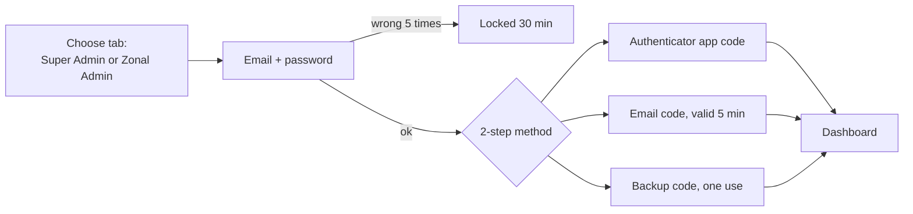

**How it works**

- **First sign-in:** a new admin changes the temporary password and sets up 2-step before seeing any page.
- **Emails:** a forgotten password is reset by an email link. A sign-in from a new device and a changed password both send an email to the admin.
- **My Account → Account security:** the admin sees their signed-in devices and can sign out the others. They can also regenerate backup codes, which asks for the password and a 2-step code again.
- **Remember me** and the 2-step policy are settings in the Control Panel (Security Settings).
- **SMS codes are built but switched off.** The SMS provider needs a registered company (DLT) first.

---

## 4. Dashboard, search and activity (4 min)

**Do:** you land on **Overview → Dashboard**.

**They see:**

- the top row: Total zones, Active zones, Zones without a team, 2-step verification;
- a banner if an access request is waiting;
- **Operations** tiles (Orders, Restaurants, Home Food, Delivery partners, Customers), with a period picker: Today, Last 7 days, Last 30 days, This month;
- charts: Orders over time, Orders by status, top restaurants and more.

**Say:**
> "This is the morning view. Without opening anything, I can see how many orders came in, how many were delivered or cancelled, which zones have no team, and what is waiting for my decision. Every tile is a link to the list behind it."

**Do:** in the top bar, change the zone picker from **All zones** to **Coimbatore Central**.

**Say:**
> "When I pick one zone, the whole panel follows: the dashboard, every list and every count."

**Do:** press **Ctrl K** (or click the search box in the top bar) and type at least two letters, for example "ravi" or "Annapoorna". Pick a result, or choose **See all results for …** (or press Enter on it) to open the full search page.

**Say:**
> "Global search finds orders, customers, vendors and partners from anywhere, only inside the zones I am allowed to see."

**Do:** open the **Audit & Logs** group in the sidebar, then **Recent Activities**.

**Say:**
> "Recent Activities is the live feed of what admins did: who, what, when, in which zone."

**How it works**

- Each tile appears only if the admin has the permission for that module. A Zonal Admin sees the same dashboard with only their zones and modules.
- The charts have a "Show as a table" option for people who prefer numbers.
- The dashboard follows the top-bar zone from the build of 2026-10-22 evening. Check it in the final QA (doc 61 §5) before showing it.

---

## 5. Zones (5 min)

**Do:** **Zone Operations → Zone Management**.

**They see:** the four zones, each with its status (Active or Upcoming), its pincodes, its team and its counts.

**Say:**
> "A zone is an area we serve, defined by its pincodes. Coimbatore Central, Coimbatore North and Tiruppur are live. Pollachi is Upcoming: it is set up but not open to customers yet."

**Do:** open **Coimbatore Central**. Show the tabs: Overview, Pincodes, Services, Team, Activity.

**Say:**
> "Each zone has its own delivery charge, its own services and its own team. In Tiruppur, for example, hotel booking is switched off."

**Do:** click **Add zone**. Fill in a name and a code. In pincodes, type one that already belongs to Coimbatore Central, for example 641005. Then cancel.

**Say:**
> "A pincode can belong to only one zone. If I type one that is already used, the panel refuses and tells me which zone has it."

**How it works**

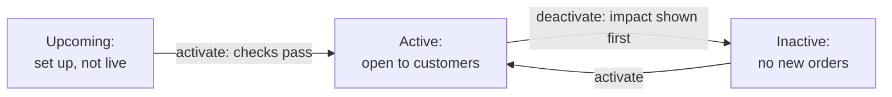

- **Activation checks** that the zone has a name, city, state, at least one pincode and a delivery charge (₹0 is allowed) before it goes live. If something is missing, the panel lists what.
- **Before you deactivate,** an impact table shows what will stop. Open orders always finish.
- A zone with history (orders, vendors) cannot be deleted. It can only be deactivated.
- **Zone Teams** (in the same menu section) shows which admins work in which zone.
- **Zone & Admin Performance** is marked "Soon": **Plan only**.

---

## 6. Control Panel: rules without code (8 min)

**Do:** **Administration → Control Panel**.

**They see:** tiles for Services by zone, People and access, Platform settings, Super Admins and the other areas.

**Say:**
> "This is the Control Panel. Every number and rule in the business lives here as a setting. Each setting has a default for the whole platform, and a zone may have its own value. Changing one never needs a developer."

**Do:** **Administration → Platform Settings**. Scroll slowly through the groups.

**Say:** (point at a few)
> "Refund limits and refund rules, the payout cycle, cancel reasons, the cash-on-delivery limit for partners, how many orders a partner carries at once, onboarding documents for each kind of vendor, support response times, reward points, order number format, and more. More than twenty rules, all in one place."

The settings, in plain words:

| Area | Settings |
|---|---|
| Money | Refund limits (zone caps), refund rules (reasons, who pays), payout cycle in days, cash-on-delivery limit per partner, delivery charge cap |
| Orders | Cancel reasons, cancellation rules, unpaid online order timeout, pre-order timing, order number format, stage time targets |
| Delivery | Orders a partner carries at once, automatic assignment (off by default; Tiruppur is ready for the pilot) |
| Vendors | Onboarding documents per vendor type (required or optional), waiting-time colours |
| People | Whether commission editing can be given to Zonal Admins, record lock timing, remember-me, 2-step policy |
| Customers | Reward points (earn rate, value, expiry, limits) |
| Messages | Support response times, notification timing and channels, SMS provider |

**Do:** pick **Coimbatore Central** in the top-bar zone picker. Find **Payouts → Payout cycle** and click **Edit**. Change 7 to 6 and click **Review change**.

**They see:** a before-and-after table and a box for the reason.

**Do:** type a reason ("Faster payouts for Coimbatore Central vendors in the launch month") and click **Save**. Enter the password when asked.

**They see:** "Payout cycle saved in Coimbatore Central". The setting now carries the label "Zone's own value".

**Say:**
> "Every change shows its effect before it is saved, needs a written reason and the admin's password, and is recorded. This value applies only to Coimbatore Central. The other zones keep the default of 7 days."

**Do:** **Audit & Logs → Settings History**.

**Say:**
> "Here is the change I just made: who, when, why, the old value and the new value."

**How it works**

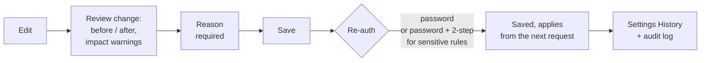

- **Which value applies:** the zone's own value if it has one, otherwise the platform default. "Remove" on a zone value returns that zone to the default.
- **Impact warnings:** if a new refund cap is lower than some admins' own limits, the review step names them.
- **Who can change:**
  - the Primary Super Admin changes everything;
  - a second Super Admin changes only the Control Panel areas granted to them;
  - Zonal Admins never change settings.
- **Not enforced yet:** the unpaid-order timeout exists as a setting, but the order flow does not apply it yet. Do not demo it as working. The cancellation rules (up to which stage an admin, vendor or customer may cancel) are enforced from the evening build of 2026-10-22.

---

## 7. People and access (8 min)

**Do:** **Administration → Super Admins**.

**Say:**
> "Arun is the Primary Super Admin, the owner's account. Meena is also a Super Admin, but she has only some Control Panel areas. Only the primary can add Super Admins or change what they control."

**Point at** the Actions column on Meena's row: **Areas**, **Make primary**, **Reset 2-step**, **Suspend** and **Remove**. Only a primary sees these, never on their own row. Each asks for the password and an authenticator code. There must always be at least one primary: the last primary can't be removed.

**Do:** **Administration → Zonal Admins**. Open **Karthik Raj**, then click through to his access page.

**They see:** Karthik's two zones as cards. Each card has:

- an Access profile (for example "Zone Manager");
- Per refund limit and Refunds per day;
- Can reveal contacts and Can export;
- Overrides;
- a Note.

On the right, **Effective access** shows his limits, the modules he sees, and his permissions in each zone.

**Say:**
> "A Zonal Admin can work in several zones, with different powers in each. In Coimbatore Central, Karthik is Zone Manager: he can refund up to ₹500 each time and ₹2,000 a day. In Coimbatore North he only runs operations: he cannot edit menus there, and his refund limit is lower. On the right I see exactly what he will see before I save."

**Do:** open **Overrides** on one zone and point at a GRANT and a DENY.

**Say:**
> "On top of the profile I can grant or deny single actions. If both apply, deny wins."

**Do:** **Administration → Access Profiles**.

**Say:**
> "Profiles are job templates: Zone Manager, Operations, Menu Desk. The locked rows are powers only a Super Admin can ever have: zones, access, settings and commission edits."

**Do:** **Audit & Logs → Access History**.

**Say:**
> "Every access change is recorded with before and after, and the member gets an email."

**How it works**

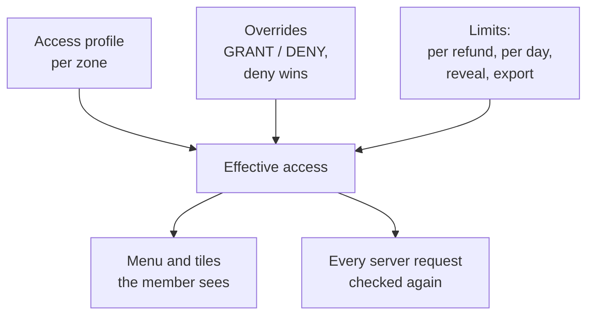

- **Adding a Zonal Admin:** **Add Zonal Admin** takes the full name, email, mobile (optional) and a temporary password (or "Generate a strong password"). The member access page then opens to give them zones. At their first sign-in the new admin:
  1. sets up 2-step with an email code (an authenticator app can be added later in Account security);
  2. saves their backup codes;
  3. must change the temporary password.

  Passwords need at least 12 characters and must not be a common password.
- **Saving an access change** asks for the password. It writes an access-history entry, emails the member and takes effect on their next click. No new sign-in is needed.
- **Access requests:** a Zonal Admin asks for a zone or a permission, with a reason. The request appears under **Requests & Approvals → Access Requests** and as a banner on the dashboard. You show this live in Part 19.

---

## 8. Vendor onboarding and vendors (10 min)

**Do:** **Requests & Approvals → Vendor Onboarding**.

**They see:**

- one queue for Restaurants, Shops, Home Food and Hotels;
- stage tabs: Submitted, Under review, More info, Decided;
- the waiting time on each row, which turns amber after 24 hours and red after 48.

**Say:**
> "A vendor (a restaurant, a shop, a Home Food cook or a cloud kitchen) applies from the vendor app with their documents. The application lands here. We check it, ask for more if something is missing, and then accept or reject it. Cloud kitchens are treated as Home Food."

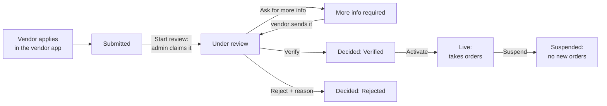

**Do:** on a Submitted row, click **Start review**.

**Say:**
> "When I start a review, the record is mine. If another admin opens it, they see that I am working on it, and they can ask me to hand it over. Two people never decide the same vendor at the same time."

**Do:** open a submitted restaurant, for example **Kovai Biryani House** or **Arya Bhavan**. Go through the documents: FSSAI, GST, PAN, bank details. Open one, then accept it, or reject it with a note.

**Say:**
> "Each document is checked on its own. The list of required documents is a Control Panel setting for each kind of vendor. Home Food cooks, for example, can give an FSSAI registration instead of a full licence, plus kitchen photos."

**Do:** in the **Decisions** card, click **Verify**.

**Say:**
> "Only a verified vendor can go live. Then I activate it, and from that moment it can take orders."

**Do:** back in the queue, open the **More info** tab. Point at a row that shows "Asked: …".

**Say:**
> "When we need more, the vendor gets our message, and the row shows what we asked, so anyone on the team can follow up."

**Do:** **Service Management → Restaurants**, then **Home Food**. Open one active vendor.

**They see:**

- status tabs with counts;
- masked phone and email in the list;
- on the vendor page: profile, documents, menu, orders, commission and zone.

**Say:**
> "Phone numbers and emails are hidden in lists. To see one, an admin clicks Reveal, and that click is recorded. The commission is set by the Super Admin. A Zonal Admin can edit it only if we switch that on in the Control Panel."

**How it works**

- **Needs a zone:** an application whose pincode is outside every zone goes to a "Needs a zone" list that only the Super Admin sees.
- **Suspend:** stops new orders; open orders still finish.
- **Moving a vendor:** a vendor can be moved to another zone, and the move is audited.
- **Hotels in onboarding:** hotels also appear in the queue, but their documents step is not built yet. Show documents on a restaurant or Home Food vendor, not on a hotel.
- **In the demo, applications are sample data.** In production they arrive from the vendor app through the signed Integration API (already built). Sending documents with the sign-up comes after the demo.

---

## 9. Menus and food item requests (4 min)

**Do:** **Service Management → Menus & Food Items**.

**Say:**
> "Every vendor's menu: items, categories, prices, stock. An admin can disable an item with a reason, for example a quality complaint, and the vendor cannot switch it back on. Bulk changes (availability, category or price for many items) are all or nothing: either every item changes or none does."

**Do:** **Requests & Approvals → Food Item Requests**. Open a pending request and **Approve** it.

**Say:**
> "When a vendor changes a price or a name in their app, it waits here. Customers keep seeing the old value until we approve. That protects customers from surprise price jumps."

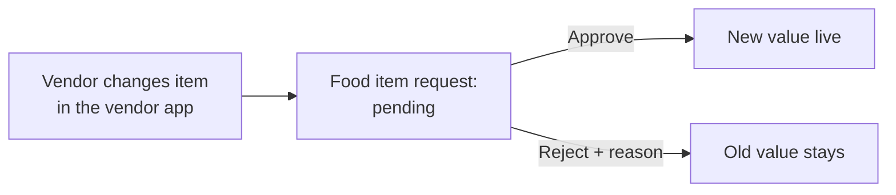

- **Not built yet:** menu import from a file is Plan only.

---

## 10. Hotels and bookings (3 min)

**Do:** **Service Management → Hotels & Bookings**. Open a live hotel. Show rooms, room bookings and table bookings.

**Say:**
> "Hotels list their rooms with capacity, and customers book rooms or tables. The panel never takes more bookings for a night than the hotel has rooms."

**How it works**

- **Room bookings:** Pending → Confirmed → Checked in → Checked out, or Cancelled.
- **Table bookings:** Pending → Confirmed → Completed, or No-show, or Cancelled.
- **Per-zone service:** hotel booking is a service switched on or off per zone. It is off in Tiruppur, and you show that in Part 19 with Suresh.

---

## 11. Vendor plans (packages) (3 min)

**Do:** **Service Management → Vendor Plans**.

**Say:**
> "These are the packages we sell to vendors. A plan starts as a draft, goes active, and is retired when we stop selling it. We can put an active vendor on a plan, with a trial if we want, or cancel it. Zonal Admins see the plans and their own vendors, but only the Super Admin changes them."

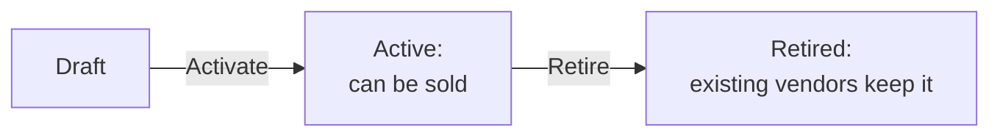

- **Not built yet:** weekly and monthly meal plans for customers are Plan only.

---

## 12. Orders (10 min)

**Do:** **Orders & Customers → Orders**.

**They see:**

- status tabs with counts;
- filters (payment method, vendor type, date);
- a zone column;
- today's live board with orders in every status.

**Say:**
> "Every order in every zone. The tabs follow the order's life, from placed to delivered."

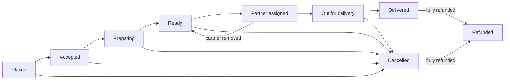

**Do:** open an order from the **Ready** tab. Show the items, payment, customer, vendor and the **timeline**.

**Say:**
> "The timeline shows every step, with who did it and when: the vendor, the partner, or an admin."

**Do:** click **Assign partner**.

**They see:** only partners from the same zone who are available and under their order limit. One partner, **Arjun Selvam**, is marked blocked, "settle first".

**Say:**
> "We only offer partners who can take the order. Arjun is holding more cash than the cash-on-delivery limit, so he gets no cash orders until he hands the cash in. The limit is a Control Panel setting."

**Do:** pick a partner and assign.

**Automatic assignment (new in the evening build of 2026-10-22; rehearse it once before showing it)**

**Do:**

1. In the top bar, pick **Tiruppur**.
2. Go to **Administration → Platform Settings**. Under **Orders**, find **Auto-assign delivery partners** and click **Edit**. Tiruppur is pre-set: 5 km radius, 60 seconds between tries, 3 tries, partner locations up to 60 minutes old.
3. Switch it on and click **Review change**.
4. Write a reason, click **Save** and enter your password.
5. Wait 10 to 40 seconds, then open the **Ready** order from Tiruppur Kongu Kitchen. If nothing has happened yet, click **Try auto-assign again** on the order.

**They see:** the order's **Automatic assignment** card says "Assigned by the system", with the partner and the distance, and the timeline says "Auto-assigned: choice 1, 1.0 km from the pickup", done by System. In the sample data, Murugan Velu is about 1 km away and Ravi Shankar about 4 km, so Murugan is picked.

**Say:**
> "Each zone can let the system assign partners. It picks the nearest partner within the radius who is online, verified, has a fresh location, is under their order limit and, for a cash order, under the cash limit. If nobody fits, the order falls back to manual assignment with an alert, and we can press 'Try auto-assign again'. Every automatic assignment is in the audit log, done by 'system'. Tiruppur is the pilot. Other zones keep manual assignment until we switch them on."

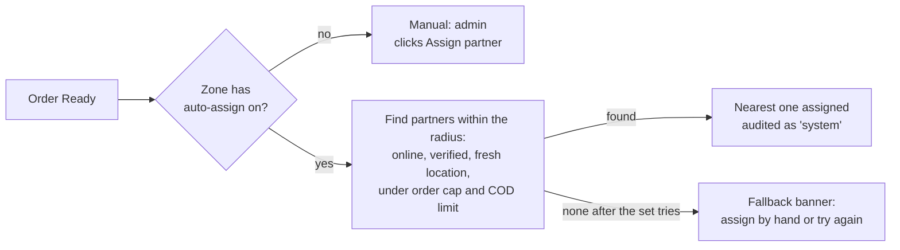

**Do:** open an order that is still **New**, **Accepted** or **Preparing**, and click **Cancel order**. Show the reasons list, then close the dialog without cancelling (or cancel it if you want to show the result).

**Say:**
> "To cancel, the admin picks a reason from the zone's list, which is also a setting. 'Other' needs a note. The Control Panel also decides up to which stage each person may cancel. By default, an order that is out for delivery can no longer be cancelled, so the button is not even shown there."

**Do (optional):** open an order in **Out for delivery** and point out that there is no Cancel button.

**Do:** **Orders & Customers → Order overview**.

**Say:**
> "Order overview is the control room:
> - open orders by stage;
> - orders running late against our time targets;
> - ready orders with no partner;
> - pre-orders that are due soon."

**How it works**

- **Status changes** follow the rules above. The panel never lets an order jump to an impossible status. Assigning needs a partner, cancelling needs a reason, and "Refunded" is set by the refunds flow only when the whole amount paid has been refunded.
- **Two admins on one order:** if two admins change the same order at once, the second one is told "This record changed. Reload" instead of overwriting the first.
- **Hidden unpaid orders:** an online order that is not paid yet stays hidden from the vendor and the admin lists until the payment arrives.
- **Pre-orders:** a customer orders for a chosen time. The order is sent to the kitchen at the right moment, and admins can reschedule or cancel it.
- **Automatic partner assignment:** it assigns directly, because the partner app cannot yet accept or decline offers. The "offer, wait, then the next partner" mode switches on once the partner app is connected. It is off by default in every zone.

---

## 13. Delivery partners and cash on delivery (4 min)

**Do:** **Delivery → Delivery Partners**. Open one partner.

**Say:**
> "Partners have documents, a verification status, an online or offline state and the cash they are holding. An admin can force a partner offline, for example after a complaint."

**Do:** **Requests & Approvals → Delivery Partner Requests**. Show **Verify**.

**Say:**
> "New partners who sign up in the partner app wait here until we verify their documents."

**Do:** **Delivery → COD Cash Settlement**.

**Say:**
> "For cash-on-delivery orders, the partner collects the cash. Here we see how much each partner holds and record when they hand it in. If the amount differs from what is due, the admin must write a note. The history shows every difference."

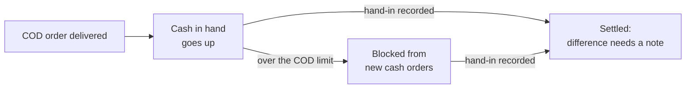

---

## 14. Customers and reward points (3 min)

**Do:** **Orders & Customers → Customers**. Open a customer.

**Say:**
> "Customers with their addresses, orders and reward points. Contact details are hidden until an admin reveals them, and the reveal is recorded. We can block a customer, for example for abuse, and unblock them later."

**Do:** on the customer, show **Reward points**: balance and history.

**Say:**
> "Customers earn points on orders. The earn rate, the value of a point, the expiry and the limits are Control Panel settings for each zone. In Coimbatore Central, for example, customers earn 5% of the order value, a point is worth ₹1, and points expire after a year. An admin can add or deduct points, always with a reason."

---

## 15. Money: refunds and payments (5 min)

**Say first:**
> "There is no payment gateway in this demo. The Razorpay connection waits for the keys from management. The flows and the rules are already built; only the bank connection is missing."

**Refunds**

**Do:** **Payments & Finance → Refunds**. Open the refund that is **waiting for approval** and click **Approve** (password).

**Say:**
> "A refund can be full, partial or a goodwill gesture, always with a reason. We also record who is at fault: the vendor, the platform or the customer. If an admin raises a refund within their own limit, it is approved straight away. Above the limit, it waits here for a Super Admin. Nobody can approve their own refund."

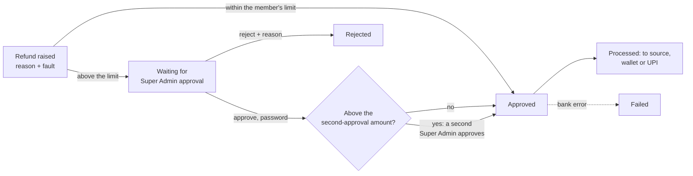

**How it works**

- **Limits:** each Zonal Admin has a per-refund and a per-day limit in each zone. The zone also has caps that no admin can go above.
- **Vendor-fault refunds:** these are taken from the vendor's next payout, in the cycle in which the refund was decided.
- **Edit responsibility** (lands in the "final-2" build): on a decided refund, a Super Admin can change who pays: the vendor (with a share %), ZOAURO, or the customer. A reason and the password are required. The dialog shows "Vendor deduction: ₹x → ₹y", and the vendor's payout follows at once. It is refused once that vendor's payout for the period is paid. Say: "If the mistake was ours, ZOAURO takes the cost, and the vendor isn't charged."

**Payments**

**Do:** **Payments & Finance → Payments**.

**Say:**
> "Every payment by method (online, cash on delivery, wallet) and by status. It is read only. When Razorpay is connected, these rows fill from the gateway."

**Exports**

- Payments, Refunds and Payouts can be exported to a spreadsheet file. The export runs in the background, and the file appears when it is ready.

---

## 16. Vendor and partner payouts (8 min)

> **Status:** the list, Mark paid and exports work on the evening build of 2026-10-22. The detail page, the statement and partner payouts land by the 11:15 freeze on 2026-10-23 and are checked on the 11:30 final build (doc 61 §5). If they are not green, show only the list and Mark paid.

**Do:** **Payments & Finance → Payouts & Reconciliation**.

**They see:**

- summary tiles at the top: Pending (count and amount to pay), Paid this cycle, Blocked by open refunds, and the next payout date for each zone;
- tabs for Restaurants, Home Food and Delivery partners.

**Say:**
> "Every cycle, the system works out what we owe each vendor and each delivery partner. The cycle length is a Control Panel setting, 7 days by default and per zone. This page tells finance what is waiting, what has been paid and what is held back."

**Do:** pick **Coimbatore Central** in the top bar. Open a pending restaurant payout.

**They see:** the payee, zone, period and status, then the **money block**: Gross, Commission, Net, Vendor-fault refunds, Ad fees, **Amount to pay**. Below it are four tabs.

**Say:**
> "For each vendor, the payout shows exactly how we got to the amount:
> - the value of the delivered orders;
> - minus our commission;
> - minus refunds that were the vendor's fault;
> - minus their advertising fees.
>
> Nothing is a black box."

**Do:** click through the tabs:

1. **Orders**: each delivered order in the period, with its commission. An order number opens the order.
2. **Refunds**: the vendor-fault refunds taken off, and any refund still open.
3. **Ad fees**: the vendor's advertising billed in this period (Part 17).
4. **History**: every action on this payout.

**Do:** click **Mark paid**. Enter the bank reference (UTR or NEFT), the date paid and your password.

**They see:** the status becomes Paid, with the reference, the date, the amount and who recorded it. The History tab shows the action.

**Say:**
> "Finance pays the vendor from the bank, then records the reference here. The panel keeps the proof: who marked it, when, and which bank transfer."

**Do:** click **Print statement**.

**Say:**
> "This is the statement we can send the vendor: the period, the money block and every order line."

**Hold, adjust and make the payout (lands in the "final-2" build at 13:00; show only if its QA is green, otherwise show Mark paid as above)**

**Do:** open a vendor payout and walk through the full details. Then:

1. **Hold** it with a reason, for example "Bank details do not match the GST certificate". A yellow banner says "On hold: … by Arun, time", and paying is blocked.
2. **Adjust amount** with a reason, for example +₹150 "Packaging reimbursement". The preview shows the new amount to pay, and the money block gains an "Adjustment" line.
3. **Release hold** with a reason.
4. **Make payout**: choose the method (NEFT, IMPS, RTGS, UPI or cheque), enter the bank reference (UTR or cheque number) and the date. The dialog shows the amount and "Recorded as made by: you".
5. The **Activity** list on the payout shows each step: who, when, why, before and after.

Each step asks for your password.

**Say:**
> "If anything doesn't match, finance holds the payout, corrects it with a reason, and only then pays. Every step is recorded with who did it and why."

**Do:** go back to the list and open **Sree Krishna Sweets**. Click **Mark paid**.

**They see:** "1 refund for this vendor is still open". The payout cannot be paid yet.

**Say:**
> "If a vendor still has a refund under review in that period, we hold the payout, so we never pay money that has to be taken back."

**Do:** open the **Delivery partners** tab and open a partner payout.

**They see:** deliveries, delivery fees, the partner's share, the cash on delivery they still hold, and the amount to pay.

**Say:**
> "Partners earn their share of the delivery fees. The share is a setting, 100% today. If a partner is still holding cash from cash-on-delivery orders, that cash is taken off their payout, so we never pay them money they already have in hand."

**Do:** mark the partner payout paid (reference, date, password).

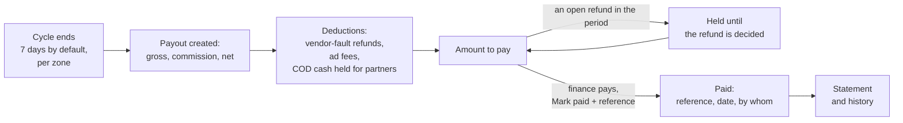

**How it works**

- **Vendor amount to pay:** net (gross minus commission), minus vendor-fault refunds decided in the period, minus ad fees billed in the period.
- **Partner amount to pay:** delivery fees on delivered orders × the partner share, minus the cash-on-delivery money the partner still holds at the end of the period. It is never below zero.
- **Who can pay:** Mark paid is for Super Admins with the payouts area. A Zonal Admin with payouts view sees their zones' payouts read only. Meena does not see Mark paid.
- **Safe to click twice:** each payment is recorded once, even if someone double-clicks or retries. If two admins open the same payout, the second is told it changed and must reload.
- **Money never moves from the panel.** Finance pays from the bank; the panel records it. Paying vendors automatically comes with the payment gateway.

---

## 17. Advertising (10 min)

> **Status:** built (e501700, sample data 88b38e0) and checked on the next demo build and the 11:30 final build (doc 61 §5). If it is not green, the menu shows "Advertising: Soon" and you show the plan instead. The figures come from the sample data: read the exact amounts from the seed log, not from this guide.

**Say first:**
> "Vendors can pay to be seen more. They can buy a banner on a page, or a top listing in their category. We sell two kinds: a flat fee per day, or a percentage commission on the orders the ad brings. The vendor asks from the vendor app, we quote, the vendor accepts, and the fee is taken from their next payout."

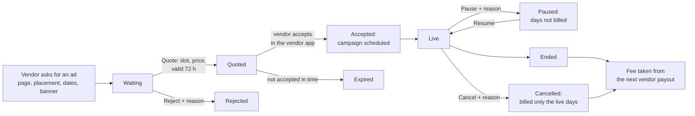

**Dashboard**

**Do:** **Support & Engagement → Advertising**.

**They see:**

- count tiles: active slots, requests waiting, quotes with vendors, campaigns scheduled, live and paused, ended in the last 30 days, and today's occupancy;
- money cards: flat ad fees billed so far, ranking commission earned, total ad revenue, and the amount due from the next vendor payouts;
- the top vendors by ad revenue.

**Say:**
> "This is our advertising business at a glance: what is running, what is waiting for us, and how much it has earned, both flat fees and commission on real orders."

**Do:** switch the top-bar zone to **Tiruppur**.

**Say:**
> "Each zone has its own ad slots and prices. Tiruppur has no hotel banner because hotel booking is off there."

**Slots**

**Do:** open the **Slots** tab (Coimbatore Central).

**Say:**
> "A slot is a place on a page we can sell: the home banner, the restaurants banner, a top listing. Each has a list price, a capacity (the home banner holds two ads at once), and a minimum and maximum number of days. We can pause, activate or retire a slot; each asks for a confirmation, and a slot can't be retired while a campaign holds it. The slots for this demo are set up in advance."

**Requests**

**Do:** open the **Requests** tab, **Waiting**. Open **Haribhavanam** (top listing, 7 days) and click **Quote**. Pick **Top listing #1** and send.

**They see:** "This slot is full on …", with the dates, because Annapoorna already holds it.

**Do:** pick **Top listing #2** at its list rate and send.

**They see:** the request moves to Quoted, valid for 72 hours, with the terms attached.

**Say:**
> "We can never sell the same place twice. The panel checks the slot's capacity for every day of the request."

**Do:** open **Sree Krishna Sweets** (home banner) and try to quote.

**They see:** "Banners need an uploaded image".

**Say:**
> "The rules are Control Panel settings: a banner needs an image, how long a quote stays valid, and so on."

**Do:** open **Lakshmi's Home Kitchen** and **Reject** it with a reason.

**Do:** open the **Quoted** or **Accepted** tab and point at **Saravanampatti Tiffin Centre**.

**Say:**
> "Once the vendor accepts our quote in the vendor app, the campaign is created and scheduled. In this demo the vendor app is not connected yet, so this accepted request was prepared in the sample data."

**Campaigns**

**Do:** open the **Campaigns** tab.

- On **Annapoorna's top listing** (a commission campaign), show the orders it brought, the order value and the commission earned.
- **Pause** Tiruppur Kongu Kitchen with a reason, then **Resume** it.
- Point at Haribhavanam: its paused days are not billed.
- Point at The Residency Towers: cancelled, billed only for the days it was live.
- Point at "Deducted from next payout".

**Say:**
> "We bill only the days an ad was really live. Pauses and cancellations are fair to the vendor. The amount due goes straight onto their next payout, which is the Ad fees line we saw in the payout."

**Settings**

**Do:** **Administration → Platform Settings → Advertising**. Change **A quote stays valid** from 72 to 48 hours (reason, password). Then open **Settings History**.

**Zonal Admin view** (when you sign in as Karthik in Part 19)

- Advertising shows only Coimbatore Central and Coimbatore North, with a zone chip on each row.
- In Coimbatore Central he can Quote and Reject. In Coimbatore North the rows are read only.
- The commission % field is locked for him, because commission is a Super Admin power.

**How it works**

- **Who sees the money:** order figures and money cards are shown only to admins who may see payments in that zone. Others see "Needs payments view".
- **Billing:** a billable day is each started 24 hours an ad was live, minus paused days. Commission campaigns earn a percentage of delivered orders from that vendor in that zone.
- **Hotels:** hotel campaigns are billed to the hotel, not taken from a payout, because hotels have no payout.
- **After the demo:**
  - vendors send requests and accept quotes from the vendor app;
  - creating and editing slots in the panel;
  - automatic start and end of campaigns;
  - export to a spreadsheet;
  - using plan ad credits.

---

## 18. Support and notifications (4 min)

**Do:** **Support & Engagement → Support Tickets**. Open a ticket.

**Say:**
> "Customer and vendor problems become tickets. Each ticket has a priority, an owner and a response timer. The target times are a setting. Tickets move from Open to Assigned, Waiting for the customer, Resolved and Closed, and a customer can reopen one."

**Do:** **Support & Engagement → Notifications**. Find the **biryani promotion** waiting for approval and **Approve** it.

**They see:** the promotion becomes Scheduled.

**Say:**
> "Admins write messages to a zone or an audience and can schedule them. Promotions need a Super Admin's approval before they go out, and quiet hours stop messages at night."

---

## 19. The Zonal Admin view (6 min)

**Do:** open the profile menu (top right) and choose **Sign out**. On the sign-in page choose the **Zonal Admin** tab and sign in as **Karthik**.

**They see:** a shorter menu, with no Control Panel, Zones or access screens. The zone picker offers "All my zones", Coimbatore Central and Coimbatore North only.

**Say:**
> "This is what a zone manager sees. Only his two zones, only the modules we gave him. He cannot even see that Tiruppur exists."

**Do:** pick **Coimbatore North** and open **Menus & Food Items**.

**Say:**
> "In Coimbatore North he can see menus but not edit them, because we denied that there."

**Do:** **Requests & Approvals → Access Requests**. Show his two pending requests in Coimbatore North: menu view and menu edit.

**Say:**
> "If he needs more, he asks, with a reason. He doesn't phone the owner; the request is recorded."

**Do:** pick **Coimbatore Central**. Open a delivered order and raise a refund of **₹600**.

**They see:** the refund is created as **Waiting for approval**.

**Say:**
> "His limit is ₹500 a refund. Anything above it goes to the Super Admin automatically."

**Do:** sign out. Sign in as **Arun** (Super Admin tab).

- Approve both of Karthik's requests: **Requests & Approvals → Access Requests**. On each row, click **Review**, write a reason, then click **Approve** and enter your password.
- Show the ₹600 refund in **Refunds**, waiting for approval.

**Do:** sign in as Karthik again. Open **Menus & Food Items** in Coimbatore North.

**Say:**
> "Now he can edit menus there, and the access history says who approved it and why."

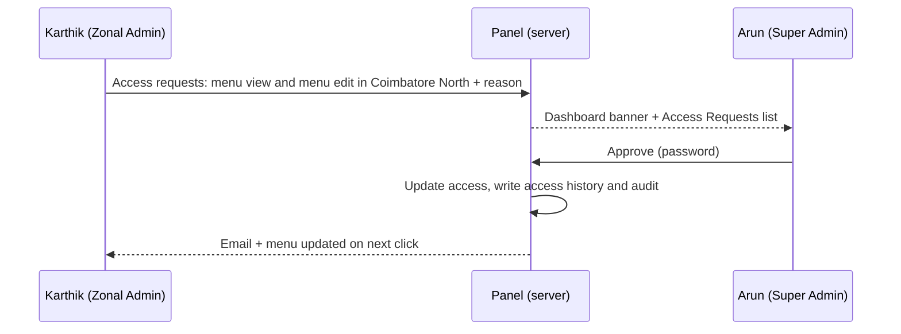

**Optional, if time allows:**

- **Priya** (Coimbatore Central, Menu Desk): the same zone as Karthik with a much narrower menu. "Two people, one zone, different jobs."
- **Suresh** (Tiruppur only): no zone switcher, and no hotel booking because that service is off in Tiruppur.

**How it works**

- **Wrong-zone records:** if a Zonal Admin types the address of a record from another zone, the server answers "not found". The check is on the server, not only in the menu.
- **Same rules everywhere:** counts, search, exports and notifications all use the same zone rules.

---

## 20. The Admin (second Super Admin) view (3 min)

**Do:** sign out, then sign in as **Meena** (Super Admin tab).

**They see:**

- all zones and all operations;
- in the Control Panel, only Services by zone, People and access, and Platform settings;
- in Platform settings, only her areas: zones, refunds, onboarding and loyalty;
- the Super Admins list is view only.

**Say:**
> "Meena runs operations across every zone, and she can change refund and onboarding rules. But she cannot change security, commissions or other admins' powers. The owner keeps those."

---

## 21. Audit trail (2 min)

**Do:** sign in as Arun again, then **Audit & Logs → Audit & Logs**. The **Audit & Logs** group holds every record screen: Audit & Logs, Recent Activities, Access History and Settings History.

**Say:**
> "Everything we did in this demo is here:
> - the setting change;
> - the vendor we verified;
> - the refund approval;
> - Karthik's access;
> - even the attempts that were refused.
>
> For each: who, what, which zone, before and after. Nothing changes in this panel without a trace."

---

## 22. What comes next (3 min)

**Do:** open one of the menu entries marked **Soon**, for example Analytics. It shows the plan for that module. Then go to the workflow map (tab 3).

**Say:**
> "What you saw today is the admin side, working on sample data. Next:
> 1. **Connect the three apps**, so real sign-ups, orders and menu changes flow in. The secure connection for the apps is already built.
> 2. **Razorpay payments and refunds**, as soon as management shares the keys. The keys will be entered in the Control Panel; until then the demo gateway stands in.
> 3. **Emails from our own domain** through Amazon SES, and **SMS codes** once the company is registered for SMS (DLT).
> 4. **Maps for zone areas**, the offer-and-accept mode for automatic assignment once the partner app is connected, then ordering from several restaurants in one checkout.
> 5. **Offers and coupons, reviews and ratings, analytics, zone and admin performance, advertising, customer meal plans.**
> 6. **Production on AWS**, and a review of splitting the system into separate services once real traffic shows where it is needed."

---

## 23. Questions you may get

| Question | Answer |
|---|---|
| Can a Zonal Admin see other zones' data if they know the link? | No. The server checks every request and answers "not found" for another zone's record. |
| What if two admins act on the same thing? | Orders: the second gets "This record changed. Reload". Onboarding: the record is claimed by whoever started the review; others can request a takeover. |
| Who can change prices, limits and rules? | Only Super Admins, from the Control Panel, with a reason and their password. The primary can limit what other Super Admins may change. |
| Can we undo a setting change? | Settings History shows the old value. Set it back the same way, or remove a zone's own value to return to the default. |
| Is customer data safe? | Phone numbers and emails are hidden in lists. Each reveal is recorded. 2-step sign-in is required for every admin. Every action is in the audit log. |
| How do refunds reach the customer today? | Recorded and processed manually, or to the customer's wallet. With Razorpay they go back automatically. |
| How are vendors paid? | Payouts per cycle (7 days by default, per zone), with our commission and vendor-fault refunds taken off. Finance records the bank reference with Mark paid. |
| What happens to open orders if we suspend a vendor or close a zone? | They finish. Only new orders stop. |
| Can a cloud kitchen join? | Yes, as Home Food, with its own document list. |
| When can we go live? | After the apps are connected, Razorpay keys are in and the production setup on AWS is done. The admin side shown today is ready for that. |

---

## 24. If something goes wrong

- **A page shows an error:** say "this is the next build step". Switch to the workflow map and show the same screen's flow there.
- **No sign-in code:** refresh Mailpit (tab 2). Codes last 5 minutes. Every demo account also has an authenticator app as a fallback.
- **"Wrong email or password" with the right password:** check the tab. Super Admin accounts use the Super Admin tab, Zonal Admins the Zonal Admin tab.
- **Everything is slow:** the laptop is short of memory. Close everything except the browser, Docker, the demo API and the demo web app.
- **A live action was already used in the rehearsal:** pick another record of the same kind (another pending refund, another submitted vendor), or skip it and explain the flow from the diagram in this guide.

---

## 25. One-page running order

| # | Part | Sign in as | Live action | Minutes |
|---|---|---|---|---|
| 2 | Big picture | — (workflow map) | — | 3 |
| 3 | Sign-in and security | Arun | Sign in with email code | 4 |
| 4 | Dashboard, search, activity | Arun | Switch zone, search | 4 |
| 5 | Zones | Arun | Pincode conflict in Add zone (cancel) | 5 |
| 6 | Control Panel | Arun | Payout cycle 7 → 6 for Coimbatore Central | 8 |
| 7 | People and access | Arun | — | 8 |
| 8 | Vendor onboarding | Arun | Start review, check documents, Verify | 10 |
| 9 | Menus, food item requests | Arun | Approve a food item request | 4 |
| 10 | Hotels | Arun | — | 3 |
| 11 | Vendor plans | Arun | — | 3 |
| 12 | Orders | Arun | Assign a partner to a Ready order; switch on automatic assignment in Tiruppur | 10 |
| 13 | Partners, COD | Arun | — | 4 |
| 14 | Customers | Arun | — | 3 |
| 15 | Refunds, payments | Arun | Approve the waiting refund | 5 |
| 16 | Payouts | Arun | Mark a vendor payout paid; print a statement; mark a partner payout paid | 8 |
| 17 | Advertising | Arun | Quote (slot full, then a free slot); reject a request; pause and resume a campaign; change the quote validity | 10 |
| 18 | Support, notifications | Arun | Approve the biryani promotion | 4 |
| 19 | Zonal Admin view | Karthik → Arun → Karthik | ₹600 refund; approve his access request | 6 |
| 20 | Admin view | Meena | — | 3 |
| 21 | Audit trail | Arun | — | 2 |
| 22 | What comes next | — | — | 3 |
| | **Total** | | | **about 112** |

**The owner requires the dashboard, payouts and advertising in every run (D203).** For a shorter run of about 75 minutes, keep Parts 2, 3, 4, 6, 7, 8, 12 (manual assignment only), 16, 17, 19 and 22, and mention the rest in one sentence each.
